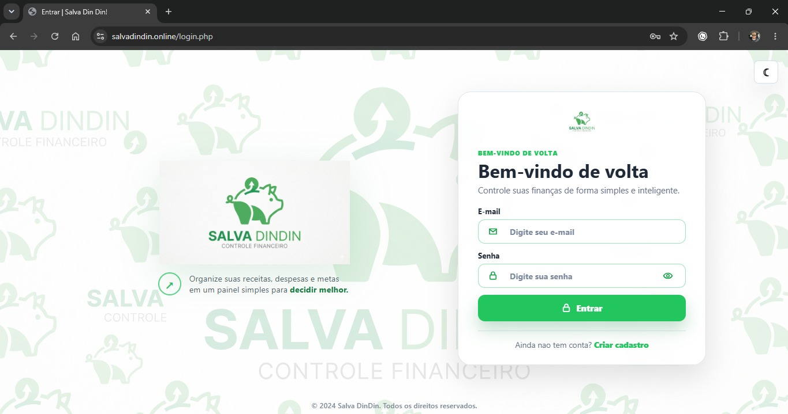
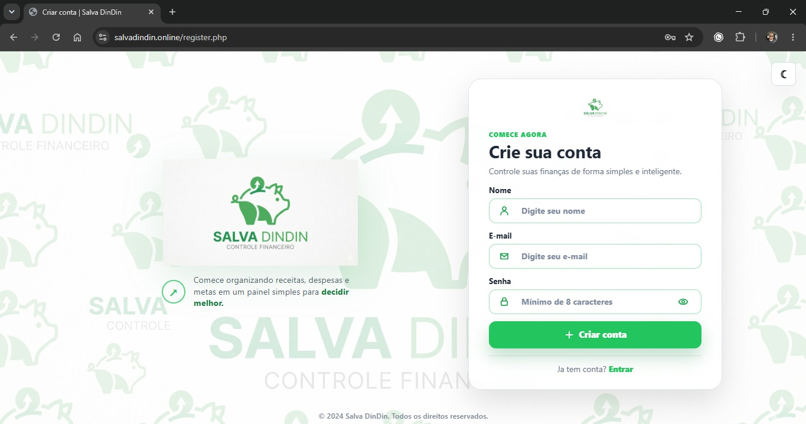
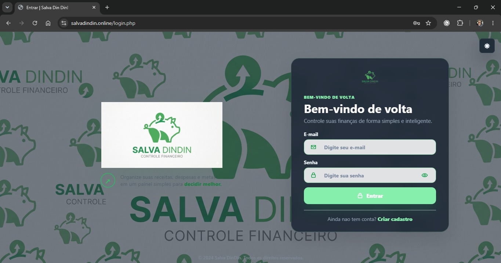
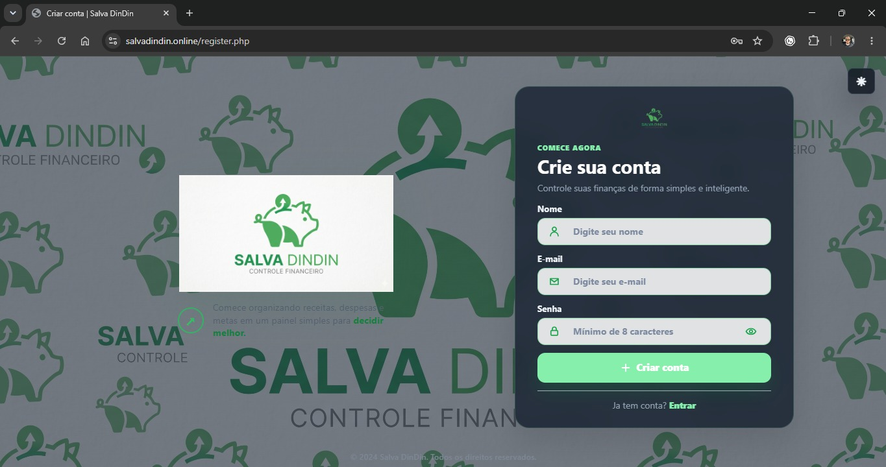

# Salvadindin

Sistema de controle financeiro pessoal desenvolvido em PHP e PostgreSQL como projeto de estudo e portfólio.

## Funcionalidades

- Cadastro e login de usuários
- Dashboard financeiro
- Lançamentos de receitas e despesas
- Metas financeiras
- Investimentos
- Painel administrativo

## Tecnologias

- PHP 8.2+
- PostgreSQL 14+
- HTML, CSS e JavaScript
- Servidor web apontando para a pasta `public`

## O que este projeto demonstra

- Desenvolvimento de aplicação web com autenticação
- Integração entre backend e PostgreSQL
- Organização de dados financeiros
- Criação de dashboard e módulos de gestão
- Configuração de ambiente por arquivo `.env`

## Configuração local

Copie o arquivo de ambiente:

```bash
cp .env.example .env
```

Ajuste as variáveis do banco de dados e da URL da aplicação no `.env`.

Depois crie o banco PostgreSQL e importe a estrutura:

```bash
psql -U salvadindin_user -d salvadindin -f database/schema.sql
```

Configure o servidor web para usar `public` como raiz do site.

## Screenshots

<p>
  
  
  
  
</p>

## Segurança

O arquivo `.env` real não deve ser publicado. Utilize apenas `.env.example` como referência e mantenha credenciais fora do repositório.

## Autor

**Jean Peixoto**  
[LinkedIn](https://www.linkedin.com/in/jeanpeixototi/) • [GitHub](https://github.com/fakersz)
